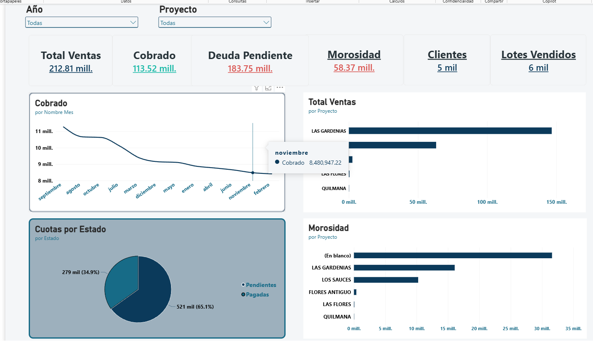
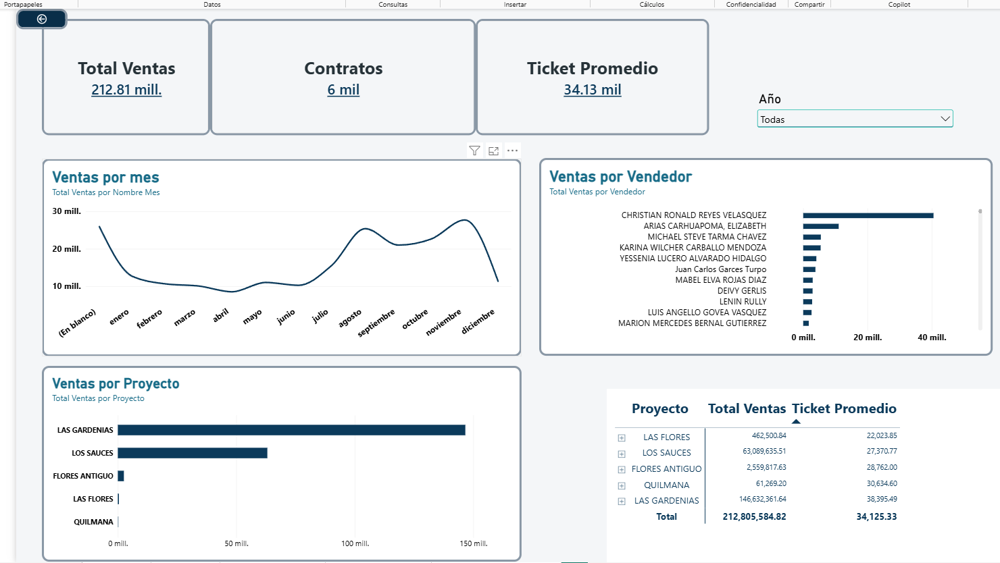
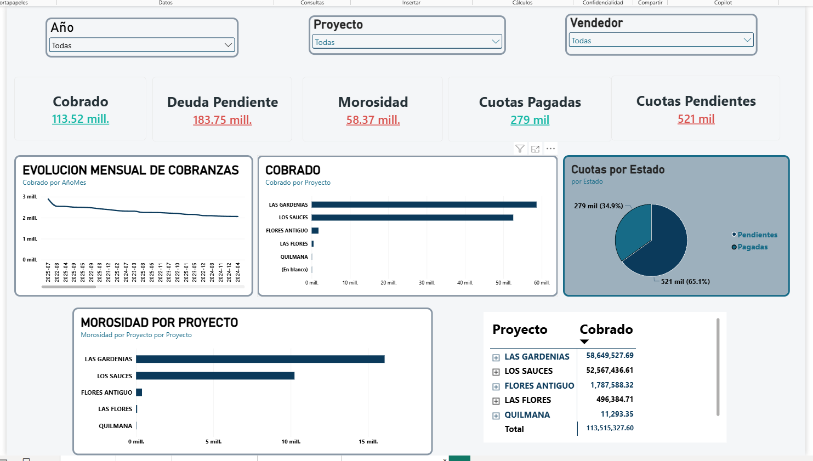

# Real Estate Management Dashboard | Power BI

## Descripción del proyecto

Dashboard interactivo desarrollado en Power BI para analizar el desempeño comercial y financiero de una empresa inmobiliaria dedicada a la venta de lotes.

El proyecto centraliza información de ventas, cobranzas y morosidad para facilitar el seguimiento de indicadores clave y apoyar la toma de decisiones.

## Objetivo empresarial

Proporcionar una visión integral del negocio mediante indicadores y visualizaciones que permitan evaluar las ventas, supervisar los cobros pendientes e identificar proyectos con mayores niveles de morosidad.

## Herramientas utilizadas

- **Power BI Desktop:** desarrollo de visualizaciones y dashboard interactivo.
- **DAX:** creación de medidas e indicadores.
- **Modelado de datos:** organización de tablas y relaciones para el análisis.

## Páginas del dashboard

### 1. Resumen Ejecutivo

Indicadores principales:
- Ventas Totales
- Cobrado
- Deuda Pendiente
- Morosidad
- Clientes
- Lotes Vendidos

Visualizaciones de ventas frente a cobranzas, ventas por proyecto, estado de cuotas y morosidad por proyecto.

### 2. Análisis de Ventas

Indicadores y análisis:
- Ventas Totales
- Contratos
- Ticket Promedio
- Evolución mensual de ventas
- Ventas por vendedor y proyecto
- Detalle de ventas por manzana y lote

### 3. Cobranzas y Morosidad

Indicadores y análisis:
- Cobrado
- Deuda Pendiente
- Morosidad
- Cuotas Pagadas
- Cuotas Pendientes
- Evolución mensual de cobranzas
- Cobrado y morosidad por proyecto
- Detalle de cobranzas por proyecto, sector, manzana y lote

## Funcionalidades

- Filtros interactivos por año, proyecto y vendedor.
- Seguimiento de indicadores comerciales y financieros.

## Capturas del dashboard

### 1. Resumen Ejecutivo

### 2. Análisis de Ventas

### 3. Cobranzas y Morosidad
